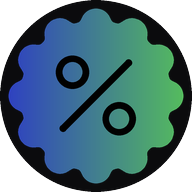

<div align="center">



# 💰 Tracker

**A private, native Android money tracker.**
Track expenses across funds, manage debts, see where your money goes, and keep it all on your device, in English or বাংলা.

<br>

[](https://github.com/darkrider13/Tracker/releases/tag/latest)

<br>


<br>

[Features](#-features) ·
[Backup](#-backup-and-restore) ·
[Install](#-getting-started) ·
[Tech stack](#-tech-stack) ·
[Structure](#-project-structure) ·
[Permissions](#-permissions)

</div>

---

## ✨ Features

| | | |
|:--|:--|:--|
| 💼 **Funds** | 📒 **Logs** | 🤝 **Debts** |
| Multiple accounts, transfers, custom categories | Search, sort and filter the full history | Owed and receivable, partial payments, reminders |
| 📊 **Stats** | 🔒 **Security** | 📤 **Backup** |
| Spending charts and debt insights | Biometric, PIN or pattern lock | Export and import as Excel or JSON |

<details open>
<summary><b>💼 Funds and transactions</b></summary>
<br>

- Multiple funds (accounts) with their own type, icon and colour. Reorder them by long-press and drag.
- Add, edit and delete expenses; add money to a fund; transfer between funds.
- Custom categories with a large icon set, plus a category slider with drag-to-reorder.
- Daily spending chart (week / month view) with a per-day tooltip.
- Balance checks and a one-day amount lock on edits to protect your history.

</details>

<details>
<summary><b>📒 Logs</b></summary>
<br>

- Full transaction history with search, sort, time and price filters.
- Calendar and wheel date pickers; days with entries are marked.
- Search highlighting and per-section notes.

</details>

<details>
<summary><b>🤝 Debts and receivables</b></summary>
<br>

- Record money you owe and money owed to you, with due date and reminder time.
- Partial payments, payment history, progress bars, priority and "key person" flags.
- Optionally link an entry to a fund so balances update automatically.
- Pending / Settled views with filters and sorting.

</details>

<details>
<summary><b>📊 Stats</b></summary>
<br>

- **Spending:** overview (total, daily average, count), top categories, and insights such as biggest expense and most active day.
- **Debts and receivables:** net position, settlement progress and top partners.
- Month filter and an "All Categories" summary sheet.

</details>

<details>
<summary><b>🔒 Security and privacy</b></summary>
<br>

- Screen lock: fingerprint / face (Android BiometricPrompt), 4-digit PIN, or pattern.
- PIN and pattern are stored only as SHA-256 hashes.
- All data stays on the device. The only network use is the optional update check.

</details>

<details>
<summary><b>⏰ Reminders</b></summary>
<br>

- Four daily expense reminders (morning, afternoon, evening, night) with editable times.
- A due-date reminder for every pending debt or receivable.
- Scheduled with `AlarmManager` (exact alarms where the device allows) and restored after reboot or app update.

</details>

<details>
<summary><b>🎨 Personalisation</b></summary>
<br>

- Dark and light mode, English and Bangla (with Bangla digits and dates), custom avatar and display name.
- Time-based greeting on the Profile screen.

</details>

---

## 📤 Backup and restore

Your data is yours. Export it, read it, bring it back.

| | 📗 Excel (`.xlsx`) | 📄 JSON (`.json`) |
|:--|:--|:--|
| **Best for** | Reading and checking your data | A plain app backup |
| **Opens in** | Excel, Google Sheets | Any text editor |
| **Import** | ✅ Auto-detected | ✅ Auto-detected |

- Tap **Export**, choose the format, then **Save File** (to Documents) or **Share**.
- **Import** accepts both formats and detects the type itself, with full validation and an all-or-nothing restore.
- Also reads backups made by the earlier web version of the app.

<details>
<summary><b>📗 What is inside the Excel backup</b></summary>
<br>

| Sheet | Contents |
|:--|:--|
| `Settings` | App settings (theme, language, username, filters, reminders) |
| `Funds` | Fund names and **balances** |
| `Transactions` | Every transaction with its **amount** |
| `Debts` | Debts and receivables with their **amounts** |
| `Debt Payments` | Payments made on each debt |
| `Categories` | Custom categories |
| `Notes` | Fund notes and Logs section notes |

> [!TIP]
> If you edit the Excel file before importing it again, keep the sheet names and header rows unchanged.

</details>

---

## 🚀 Getting started

### 📲 Install

Download the latest APK from the [Releases page](https://github.com/darkrider13/Tracker/releases/tag/latest) and install it. Android may ask you to allow installs from your browser or file manager.

### 🛠️ Build locally

Requirements: JDK 17 and Android Studio (or the Android SDK command-line tools).

```bash
git clone https://github.com/darkrider13/Tracker.git
cd Tracker
gradle assembleDebug
```

The APK is written to `app/build/outputs/apk/debug/app-debug.apk`.

> [!NOTE]
> The debug build is signed with the project keystore when `app/tracker.keystore` and the `KEYSTORE_PASSWORD` environment variable are present. Without them the build is signed with Android's default debug key.

### ⚙️ Build with GitHub Actions

Every push to `main` (or a manual run) builds the app and publishes it.

1. In the repository, open **Settings → Secrets and variables → Actions** and add:
   - `KEYSTORE_BASE64`: your keystore file, base64-encoded
   - `KEYSTORE_PASSWORD`: the keystore password
2. Push to `main`, or run the **Build Kotlin Android APK** workflow manually.
3. The workflow publishes `Tracker.apk` and `version.json` to the `latest` release.

Version numbers are generated automatically: `versionCode = 1000 + run number` and `versionName = 2.0.<run number>`, so each build installs as an update over the previous one.

---

## 🧰 Tech stack

| Area | Choice |
|:--|:--|
| 🟣 Language | Kotlin 2.0.20 |
| 🎨 UI | Jetpack Compose (BOM 2024.09.00), custom components, no Material dependency |
| 📱 Min / target SDK | 22 / 34 |
| 🏗️ Build | Gradle 8.9, Android Gradle Plugin 8.5.2, JDK 17 |
| ⚡ Async | Kotlin Coroutines |
| 🔐 Auth | AndroidX Biometric |
| 💾 Storage | Local JSON state with atomic file writes |
| 🔁 CI / CD | GitHub Actions, GitHub Releases |

---

## 🗂️ Project structure

```
app/src/main/
├── assets/i18n_bn.json         Bangla translation table
├── java/com/myapp/app/
│   ├── MainActivity.kt
│   ├── data/                   Models, AppStore, JSON and Excel backup/import, session, reminder settings
│   ├── reminder/               Notification channel, alarms, boot receiver
│   ├── util/                   Money and date formatting, i18n, digits, categories, update checker
│   └── ui/
│       ├── TrackerRoot.kt      App shell and tab host
│       ├── AppUi.kt            Tab and panel state
│       ├── theme/              Colours, fonts, system bars
│       ├── components/         Bottom nav, charts, wheel picker, icons, shared widgets
│       ├── screens/            Home, Logs, Debts, Stats, Profile, Fund Details
│       └── popup/              Add/edit dialogs, pickers, lock screens, backup, reminders
└── res/                        Icons, splash, themes, file provider paths
```

---

## 🔐 Permissions

| Permission | Why |
|:--|:--|
| `POST_NOTIFICATIONS` | Show reminders |
| `SCHEDULE_EXACT_ALARM`, `USE_EXACT_ALARM` | Deliver reminders at the chosen time |
| `RECEIVE_BOOT_COMPLETED` | Re-register reminders after a reboot |
| `USE_BIOMETRIC` | Fingerprint / face lock |
| `INTERNET` | Check for and download app updates |
| `REQUEST_INSTALL_PACKAGES` | Install a downloaded update |
| `READ/WRITE_EXTERNAL_STORAGE` (Android 9 and below) | Save and read backup files |

---

## 🗃️ Data and backups

- Data is stored in the app's private storage. Transactions older than 6 years and settled debts older than 15 years are purged automatically.
- Backup files (Excel and JSON) use the type `smart_saver_elite_backup` (version 2). Unknown fields are preserved on import.
- To move data from an older version, export from the old app and import in the new one from the Profile screen.

---

## 🤝 Contributing

This is a personal project, but issues and suggestions are welcome. For code changes, open an issue first to discuss what you would like to change.

---

<div align="center">

© Md. Insanul Islam Abir. All rights reserved.

</div>
